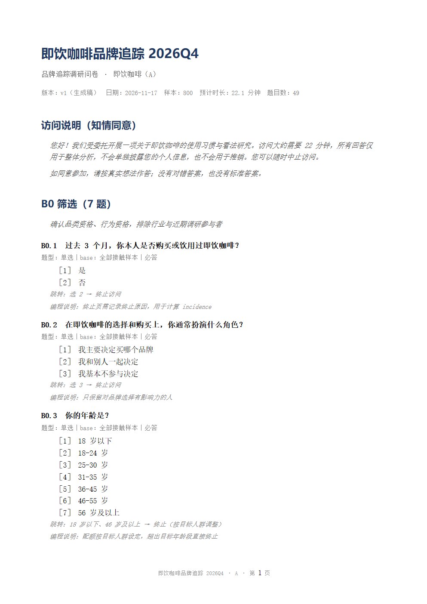
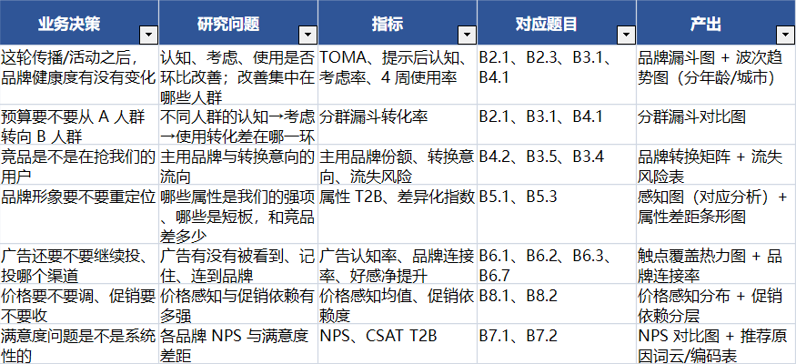

# Consumer insight desk · dsh-consumer-insight

> Fill in an objective and a research type; get a questionnaire you can send to a fieldwork agency, an analysis framework you can take into a meeting, and a concrete plan for how the sample should be allocated.

A DeepSeek Harness plugin. It turns the slowest four parts of consumer research — deciding what to ask, writing the questionnaire, preparing the analysis framework, and sizing the sample — into standard templates plus a form. Generation is deterministic: no network, no model calls, reproducible output. Personalisation happens afterwards, in chat, by changing parameters and regenerating.





## Why

Questionnaires usually start from the last one, modules are recalled from memory, the analysis framework is invented after the data arrives, and quotas are guessed. The result: questions nobody analyses, analyses nobody asked for, and numbers that do not match the agency's definitions.

This project encodes the standard practice for two research types (brand tracker, customer satisfaction) into playbooks, then instantiates them with project parameters:

- **Playbook**: module sequence, question bank, metric definitions, analysis framework, sampling rules.
- **Project parameters**: category, brands, audience, market, sample size.
- **Rule engine**: randomisation, routing, base, duration estimates, automatic checks.

## Features

- Two research types: **brand tracker** (9 modules / 49 questions) and **customer satisfaction, CSAT·NPS** (9 modules / 40 questions).
- Six required fields: objective, type, category, brand, audience, sample size.
- Automatic checks: module completeness, duration, number of open-ends, routing closure, leading wording, per-cell sample. Errors block saving.
- Outputs Word, Excel, Markdown and CSV; the same content is also exposed to the agent through three tools.

## Install

Requires DeepSeek Harness `0.2.1-rc.5` or later (`< 0.3`). No model is needed for generation.

```bash
dsh plugin --profile desktop add git+https://github.com/<owner>/dsh-consumer-insight.git

# or from a local directory
dsh plugin --profile desktop add /path/to/dsh-consumer-insight
```

Then open **Consumer insight desk** in the left sidebar. UI changes need a page refresh; host changes need a DSH restart.

## Usage

1. Open the sidebar entry.
2. Fill in the objective (what decision it supports), the research type, category, brands, audience and sample size. "Fill example" is a good first run.
3. Click **Generate** and review the five tabs: brief, questionnaire, analysis framework, sampling, files.
4. Click **Save to computer** to write the Word/Excel/Markdown/CSV set.
5. To iterate, change parameters and regenerate, or ask the agent to call `insight_generate`.

Output defaults to `~/Documents/消费者洞察`; change it from the directory label in the top-right corner or with `DSH_CONSUMER_INSIGHT_DIR`.

## What you get

| File | Content |
| --- | --- |
| `00-项目简报.md` | Objective, decisions, research questions, metrics, sample, deliverables |
| `01-研究设计.md` | Screening logic, sample design, quality control, schedule, risks |
| `02-问卷.docx` | Word questionnaire: no cover page, consent, modules and questions, grid tables, page footer |
| `02-问卷.md` / `.csv` | Readable version / programming flat file |
| `03-分析框架.xlsx` | Four sheets: traceability, metric definitions, crosstabs and banners, chart list |
| `03-分析框架.md` | Eight sections incl. advanced analysis, report outline, data delivery spec |
| `04-抽样与配额.md` | Precision, three allocation plans, full quota, weighting, reach, cost, schedule, adjustment rules |
| `04-配额表.csv` | 24 cells, ready to paste into Excel |
| `05-码表.csv` | Variable names, coding, base, missing values |
| `06-执行与QC清单.md` | Before programming, pilot, fieldwork, data return, before delivery |
| `project.json` | Parameters and result, re-generatable |

## Sampling module

Not just a sample size — a plan for how to allocate it:

- **Precision table**: n versus margin of error and effective sample (95% confidence, p=0.5, design effect 1.2).
- **Three plans**: proportional (best representativeness), equal by key groups (best for subgroup comparisons), proportional with a floor (recommended).
- **Full quota**: city tier × gender × age, 24 cells, with sample share, population share and design weight.
- **Reach and cost**: invitations needed (incidence × response rate), total interview hours, field days, total cost.
- **Schedule and adjustment rules**.

## Agent tools

| Tool | Purpose |
| --- | --- |
| `insight_playbook` | List research types; read one playbook's modules, metrics and sampling guidance |
| `insight_generate` | Generate the full deliverable set from the same parameters; returns paths and check summary |
| `insight_project` | List / read / delete recent projects; read returns parameters for re-generation |

## Privacy

- Draft and project index: `~/.dsh/consumer-insight/state.json`.
- Generated files: the configured output directory.
- No network, no model calls, no uploads, no analytics.

## Scope and caveats

- Generated drafts are a professional skeleton plus project customisation. **A researcher must review them** and confirm brand, channel and price definitions with the client before fieldwork.
- No benchmark data is invented; missing benchmarks are marked as "to be sourced".
- Quotas, cost and schedule are recommendations, subject to the sampling frame and agency quotes.
- The questionnaire includes informed consent; minors are excluded; follow the ICC/ESOMAR International Code and applicable data protection law.

## Development

No third-party runtime dependencies: Node built-ins plus a native OOXML writer.

```bash
node build.mjs          # build client.js from src/*.js
node tests/smoke.mjs    # generate both research types, check structure, quotas, Office packages
node tests/host.mjs     # run routes and the three tools against a fake ctx
node tests/panel.mjs    # render the panel and four views with a React stub
```

## License

[MIT](LICENSE)
