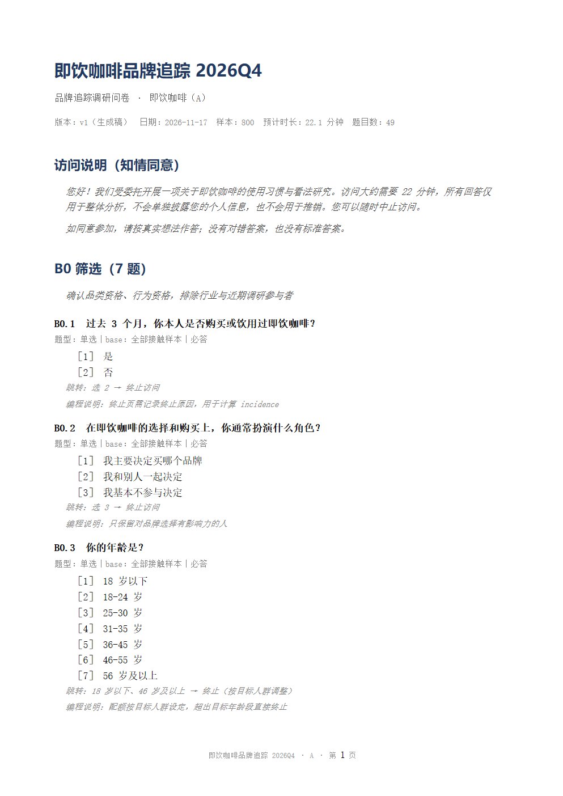
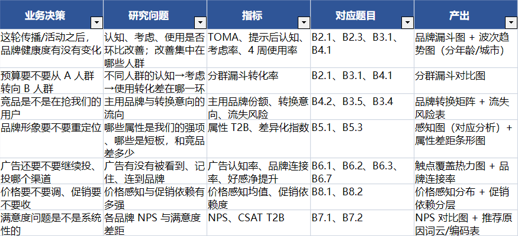

# 消费者洞察工作台 · dsh-consumer-insight

> 填项目目标与调研类型，生成一份能直接发给代理的问卷、一份能带进会议的分析框架，以及一套「样本怎么分」的抽样配额。

DeepSeek Harness 插件。把消费者调研里最费时的四件事——判断该问什么、写问卷、备分析框架、算样本怎么分——做成标准件 + 填表生成。生成是确定性的：不联网、不调用模型、结果可复现；要个性化时再在对话里让 Agent 改参数重生成。





## 为什么做

项目启动时，问卷常常是从上一份里改的，模块该有哪些靠记忆，分析框架等数据回来才想，抽样配额靠经验估。结果是：问了的不分析、要分析的没问、和代理对不上口径。

这个项目把品牌追踪与用户满意度两类调研的标准做法沉淀成「标准件」，再按项目参数实例化：

- **标准件**：模块序列、问题库、指标口径、分析框架、抽样规则。
- **项目参数**：品类、品牌、人群、市场、样本量。
- **规则引擎**：随机化、跳转、base、时长估算、自动体检。

## 能做什么

- 两类调研：**品牌追踪**（9 模块 / 49 题）、**用户满意度 CSAT·NPS**（9 模块 / 40 题）。
- 填 6 个必填项即可生成：目标、类型、品类、主品牌、目标人群、样本量。
- 自动体检：模块完整性、时长、开放题数量、跳转闭环、引导性表达、单元格样本量；错误会阻止保存。
- 输出 Word、Excel、Markdown、CSV；同一套内容也通过 3 个 Agent 工具供对话使用。

## 快速开始

要求 DeepSeek Harness `0.2.1-rc.5` 及以上（`0.3` 以下），本机已配好模型不是必需——生成不调用模型。

```bash
# 从 GitHub 安装
dsh plugin --profile desktop add git+https://github.com/poweredbyai/dsh-consumer-insight.git

# 或安装本地目录
dsh plugin --profile desktop add /path/to/dsh-consumer-insight
```

也可以在 DSH「插件 → 添加插件」里选本地目录。装好后左侧栏出现「消费者洞察」，点开即用。界面改动刷新页面生效；Host 侧改动需要重启 DSH。

## 怎么用

1. 点左侧栏「消费者洞察」。
2. 填项目目标（写清要做什么决策）、选类型、填品类/品牌/人群/样本；第一次可以先点「填入示例」。
3. 点「生成方案」，右侧看「简报 / 问卷 / 分析框架 / 抽样 / 文件」。
4. 点「保存到电脑」，文件落到输出目录。
5. 想改：回面板改参数重新生成，或在对话里让 Agent 调 `insight_generate` 重生成。

输出目录默认 `~/Documents/消费者洞察`（Windows 为 `C:\Users\<你>\Documents\消费者洞察`），点右上角目录名即可更改，也可用环境变量 `DSH_CONSUMER_INSIGHT_DIR` 指定。

## 生成什么

| 文件 | 内容 |
| --- | --- |
| `00-项目简报.md` | 目标、业务决策、研究问题、指标、样本、交付清单 |
| `01-研究设计.md` | 筛选逻辑、样本设计、质控、排期、风险 |
| `02-问卷.docx` | Word 问卷：无封面、访问说明、模块与题目、网格表格、页脚页码 |
| `02-问卷.md` / `.csv` | 可检索版 / 编程用平面表 |
| `03-分析框架.xlsx` | 4 张表：追溯表、指标定义、交叉表与分组、图表清单 |
| `03-分析框架.md` | 8 个部分：追溯、指标、banner、交叉表、高级分析、图表、大纲、数据规范 |
| `04-抽样与配额.md` | 精度、三种分配方案、完整配额、加权、接触量、成本、排期、调整规则 |
| `04-配额表.csv` | 24 个交叉格，可直接贴进 Excel |
| `05-码表.csv` | 变量名、编码、base、缺失值 |
| `06-执行与QC清单.md` | 编程前、试访、正式访问、数据回收、交付前 |
| `project.json` | 项目参数与结果，可改完再生成 |

## 抽样模块：样本怎么分

给的不是一个数字，而是一套可执行的分配建议：

- **精度表**：n 与误差、有效样本（95% 置信、p=0.5、设计效应 1.2）。
- **三种方案**：
  - A 比例分配：按市场结构，代表性最好、加权最少；
  - B 分组等分：城市级别与年龄等分，适合做人群比较；
  - C 比例 + 保底（推荐）：以比例为主，每个交叉格抬到 20 以上。
- **完整配额**：城市 3 × 性别 2 × 年龄 4 = 24 格，含样本占比、总体占比、设计权重。
- **接触量与成本**：需接触人数（incidence × 回应率）、总访谈时长、田野天数、总成本。
- **排期与调整规则**：某格招不满、低线贵、incidence 过低、要检测更小差异时怎么改。

## 对话里用

| 工具 | 作用 |
| --- | --- |
| `insight_playbook` | 查标准件：支持的调研类型、模块、指标、抽样建议 |
| `insight_generate` | 用与面板相同的入参生成全套文件，返回路径与体检摘要 |
| `insight_project` | 查看 / 读取 / 删除最近项目；读取返回参数，可改完重生成 |

例：`用品牌追踪的方法，给即饮咖啡 A 品牌做一份 18-30 岁人群的问卷，加一道校园场景题。`

## 数据与隐私

- 表单草稿与项目索引：`~/.dsh/consumer-insight/state.json`。
- 生成的文件：输出目录（默认 `~/Documents/消费者洞察`）。
- 生成过程不联网、不调用模型、不上传任何内容；没有埋点、没有账号体系。

## 边界

- 生成稿是专业骨架 + 项目定制，**投放前必须由研究员审校**，并与客户确认品牌、渠道、价盘口径。
- 不生成「行业平均」「竞品实测值」等基准数据；需要时在文件里标注待补来源。
- 配额、成本、排期是建议值，最终以抽样框与代理报价为准。
- 问卷含知情同意；排除未成年人；遵循 ICC/ESOMAR 国际准则与《个人信息保护法》。

## 开发

无第三方运行时依赖，Node 内置模块 + 原生 OOXML 生成器。

```bash
node build.mjs          # 把 src/*.js 拼成 client.js（浏览器侧）
node tests/smoke.mjs    # 生成两类项目，检查结构、配额与 Office 文件包
node tests/host.mjs     # 用假 ctx 跑接口与 3 个工具
node tests/panel.mjs    # 用 React 替身渲染面板与四个视图
```

| 目录 | 内容 |
| --- | --- |
| `index.js` | Host 半片：接口、落盘、Agent 工具 |
| `src/playbooks/` | 调研标准件（模块、问题库、指标、分析框架、抽样建议） |
| `src/generate.js` | 参数替换、体检、分析框架装配 |
| `src/sampling.js` | 分配、精度、接触量、排期 |
| `src/render/` | Markdown / CSV / Word / Excel 文档规格 |
| `src/ooxml/` | 无依赖 DOCX / XLSX 生成器 |
| `src/panel*.js` | 整页工作台 |
| `src/main.js` | 客户端注册（主面板 + 侧栏入口） |
| `build.mjs` | 无依赖拼接构建 |

想加一类调研？见 [CONTRIBUTING.md](CONTRIBUTING.md)。

## License

[MIT](LICENSE)

